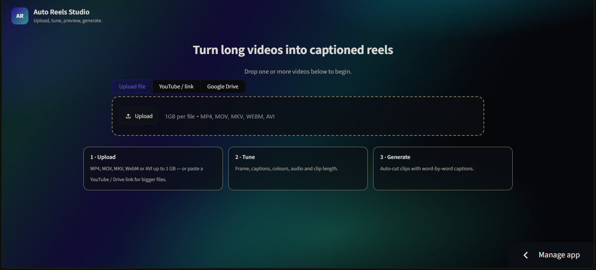
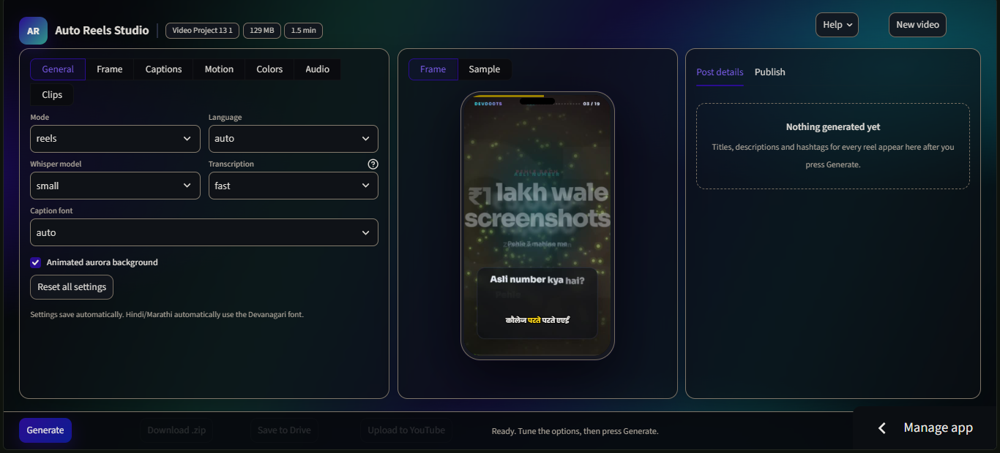
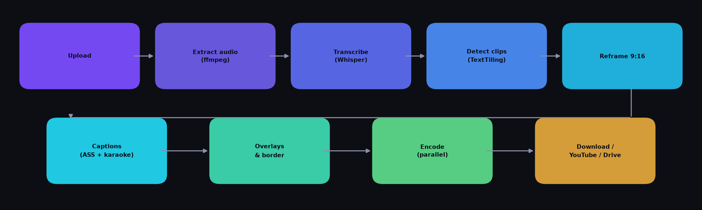

<div align="center">

# Auto Reels Studio

**Turn long videos into caption-ready vertical reels — automatically, and completely free.**

[**Open the live app →**](https://auto-reel-maker.streamlit.app)


</div>

---

## Overview

**Auto Reels Studio** converts a long video — a lecture, podcast, interview, webinar or screen
recording — into a set of short **9:16 vertical reels** with captions already burned in.

It transcribes the video with an open-source Whisper model, finds the moments where the topic
changes, reframes them for Reels/Shorts, renders styled captions (including Hindi), and packages
everything into a ready-to-post ZIP. The finished clips can also be pushed straight to
**YouTube** or **Google Drive**.

No watermark. No clip limit. No subscription.

> Built as a mini project for **B.Tech CSE (AI & ML)** at *M G Institute of Management & Technology*.

---

## Screenshots

| Start screen | Editor |
| :---: | :---: |
|  |  |

<p align="center"><em>Upload a file, paste a YouTube / Instagram / X / Vimeo link, or pick a file from Google Drive — then tune and generate.</em></p>

---

## Features

### Input
- **Upload a file** — MP4, MOV, MKV, WebM, AVI (up to 1 GB per file).
- **Paste a link** — YouTube, Instagram, X, Vimeo or a direct `.mp4` URL via `yt-dlp` (up to 1080p).
- **Google Drive** — fetch a file shared as *“Anyone with the link”* via `gdown`.
- Links are downloaded straight to disk, so large files never sit in RAM.

### Automatic processing
- **Speech recognition** with `faster-whisper` — segments *and* word-level timestamps.
- **Smart clip detection** — TF-IDF + cosine similarity with a TextTiling depth score finds natural
  topic boundaries, so clips follow the content instead of arbitrary cuts.
- **Parallel rendering** — clips are encoded concurrently with a thread pool.

### Captions
- **Karaoke captions** — the word being spoken is highlighted as it is said.
- Styles: `karaoke` · `plain` · `none`; highlight as **colour** or **box**.
- Full typography control: font, size, colour, outline width, box + opacity, position
  (bottom / middle), words per line, UPPERCASE.
- **Hindi / Devanagari** support with a bundled *Noto Sans Devanagari* font.
- Animations: `pop`, `fade`, `none`.

### Framing & effects
- **Three framing modes**: blurred background (`fit_blur`), solid colour (`fit_color`), or a custom
  zoomed crop (`crop` with zoom + X/Y focus).
- Optional **border**, **progress bar**, **slow zoom**, **fade in/out**, and **overlay text**.
- Animated **aurora background** in the UI (can be switched off).

### Audio
- Keep or **mute** the original audio, with volume control.
- Add your own **background music** with an independent volume.

### Output
- Vertical **1080 × 1920** clips, H.264 + AAC.
- A full **timestamped transcript**.
- **`post_details.txt`** with an auto-generated title, description and hashtags for every reel.
- One-click **YouTube** upload (private / unlisted / public) and **Google Drive** save.
- Settings are saved automatically and restored on your next visit.

---

## How it works



```
Upload ─▶ Extract audio ─▶ Transcribe ─▶ Detect clips ─▶ Reframe 9:16
       ─▶ Render captions ─▶ Overlays ─▶ Encode (parallel) ─▶ Download / YouTube / Drive
```

1. **Extract audio** — FFmpeg decodes the track to 16 kHz mono float32.
2. **Transcribe** — `faster-whisper` returns segments and word-level timings.
3. **Detect clips** — TF-IDF vectors → cosine similarity across neighbouring blocks → depth score
   → boundaries → merged/split to the chosen min/max duration.
4. **Reframe** — FFmpeg filter graph builds a blurred background, solid colour, or a custom crop.
5. **Captions** — an ASS subtitle file is generated per clip with the chosen typography and karaoke
   highlight, then rendered with `libass`.
6. **Composite** — border, progress bar, overlay text, animation and music are mixed in.
7. **Encode** — clips render in parallel; results are zipped, or uploaded to YouTube / Drive.

---

## Quick start

The easiest way is to use the hosted app — nothing to install:

**https://auto-reel-maker.streamlit.app**

1. Upload a video (or paste a link).
2. Pick a tab — **General · Frame · Captions · Motion · Colors · Audio · Clips** — and set the options.
3. Check the **live preview** (a real frame of your video with your settings drawn on top).
4. Press **Generate**, then **Download zip**, **Save to Drive** or **Upload to YouTube**.

---

## Run locally

```bash
# 1. Clone
git clone https://github.com/Devdootjii/auto-reel-maker.git
cd auto-reel-maker

# 2. Create an environment (Python 3.10+)
python -m venv .venv
source .venv/bin/activate        # Windows: .venv\Scripts\activate

# 3. Install dependencies
pip install -r requirements.txt

# 4. Run
streamlit run app.py
```

Then open <http://localhost:8501>.

> **FFmpeg** ships with `imageio-ffmpeg`, so no separate system install is needed.
> For GPU transcription, install a CUDA-enabled `ctranslate2` — the app falls back to CPU automatically.

---

## Deploy on Streamlit Community Cloud

1. Fork or push this repository to your GitHub account.
2. Go to <https://share.streamlit.io> → **Create app** → pick this repo.
3. Main file path: **`app.py`**.
4. Open **Advanced settings** → **Python version** → choose **3.12** (recommended).
5. **Deploy**.

> **Why Python 3.12?** On Python 3.14, `tokenizers` has no prebuilt wheel and would need Rust to
> compile. This project pins `tokenizers>=0.22`, which ships a stable-ABI (`abi3`) wheel that works
> on every Python ≥ 3.10 — but 3.12 is the safest choice on the free host.

---

## Configuration reference

| Setting | Options | Default | What it does |
| --- | --- | --- | --- |
| **Mode** | `reels` · `full_video` · `transcribe_only` | `reels` | Split into clips · caption the whole video · transcript only |
| **Language** | `auto`, `hi`, `en`, `bn`, `ta`, `te`, `mr`, `gu`, `kn`, `ml`, `pa` | `auto` | Pin the spoken language (use `hi` for Hindi/Hinglish) |
| **Whisper model** | `tiny` · `base` · `small` · `medium` | `small` | Larger = more accurate but slower on CPU |
| **Transcription** | `fast` · `accurate` | `fast` | Speed/accuracy trade-off |
| **Caption font** | `auto`, Poppins, Anton, Montserrat, Bebas Neue, Noto Sans Devanagari | `auto` | `auto` picks Poppins, or Noto Sans Devanagari for Hindi |
| **Frame mode** | `fit_blur` · `fit_color` · `crop` | `fit_blur` | Blurred background · solid colour · custom zoom crop |
| **Caption style** | `karaoke` · `plain` · `none` | `karaoke` | Word highlight · plain line · no captions |
| **Highlight** | `color` · `box` | `color` | How the active word is emphasised |
| **Caption position** | `bottom` · `middle` | `bottom` | Where the caption sits |
| **Caption animation** | `pop` · `fade` · `none` | `pop` | Entry animation |
| **Original audio** | `keep` · `mute` | `keep` | Keep the original sound or silence it |
| **Preview** | `frame` · `video` | `frame` | Instant mock preview · short rendered sample |
| **Privacy** | `private` · `unlisted` · `public` | `private` | YouTube upload visibility |

---

## Project structure

```
auto-reel-maker/
├── app.py                  # Streamlit UI + pipeline orchestration
├── engine.py               # Rendering / transcription core
├── requirements.txt        # Python dependencies
├── SETUP_STEPS.md          # Deployment and update notes
├── .streamlit/
│   └── config.toml         # Upload limit, dark theme, toolbar settings
└── docs/
    ├── screenshot-home.png
    ├── screenshot-editor.png
    └── pipeline.png
```

---

## Tech stack

| Layer | Technology |
| --- | --- |
| UI | [Streamlit](https://streamlit.io) + custom HTML/CSS |
| Speech recognition | [faster-whisper](https://github.com/SYSTRAN/faster-whisper) (CTranslate2) |
| Clip detection | [scikit-learn](https://scikit-learn.org) — TF-IDF + cosine similarity |
| Media processing | [FFmpeg](https://ffmpeg.org) with `libass`, `gblur`, `drawbox`, `zoompan` |
| Link downloads | [yt-dlp](https://github.com/yt-dlp/yt-dlp), [gdown](https://github.com/wkentaro/gdown) |
| Publishing | [YouTube Data API v3](https://developers.google.com/youtube/v3), [Google Drive API](https://developers.google.com/drive) |
| Language | Python 3 |

---

## Limitations

- The free host is **CPU-only**, so transcribing hour-long videos takes considerably longer than on a GPU.
- Memory on the free tier limits the model size — `small` is the practical maximum.
- Clip detection relies on **spoken content**; it is not suitable for music-only or silent videos.
- Instagram publishing is not implemented — the API requires a Business account and publicly hosted media.
- YouTube and Drive publishing need a one-time OAuth setup with your own `client_secret.json`.

---

## Roadmap

- [ ] Face-tracking reframe for talking-head videos
- [ ] Word-level karaoke timing and more caption presets
- [ ] Background-music library with beat-synced cuts
- [ ] Instagram Reels publishing
- [ ] Subtitle translation and dubbing
- [ ] GPU-hosted transcription
- [ ] Shareable custom presets

---

## Credits

Built on the shoulders of excellent open-source work:
[OpenAI Whisper](https://github.com/openai/whisper) ·
[faster-whisper](https://github.com/SYSTRAN/faster-whisper) ·
[FFmpeg](https://ffmpeg.org) / [libass](https://github.com/libass/libass) ·
[Streamlit](https://streamlit.io) ·
[scikit-learn](https://scikit-learn.org) ·
[yt-dlp](https://github.com/yt-dlp/yt-dlp) ·
[gdown](https://github.com/wkentaro/gdown)

The clip-boundary approach follows Hearst, M. A., *“TextTiling: Segmenting Text into
Multi-paragraph Subtopic Passages”*, Computational Linguistics, 1997.

---

## License

Released under the **MIT License** — free to use, modify and share.

---

<div align="center">

Made by **[Divyansh Kumar](https://github.com/Devdootjii)**

If this saved you time, consider giving the repo a ⭐

</div>
